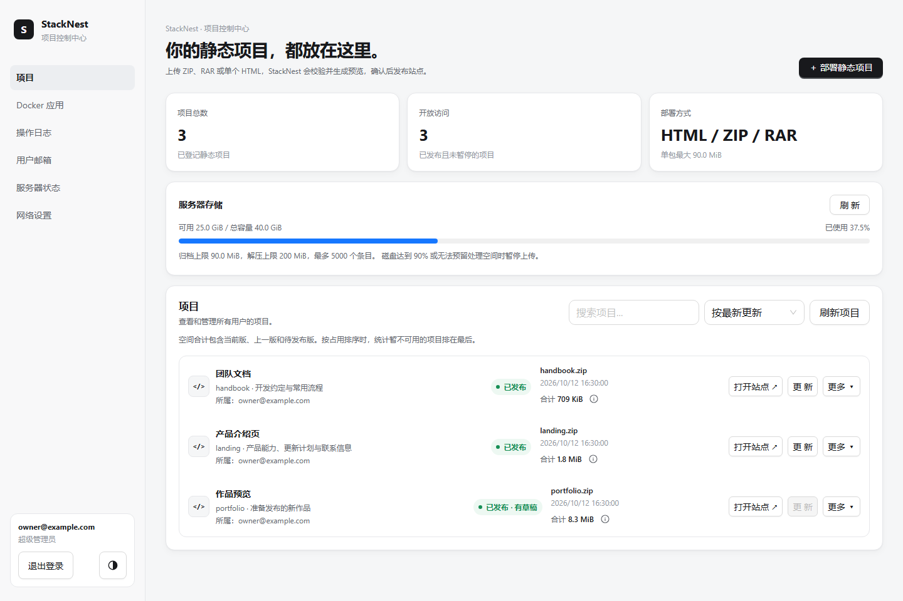
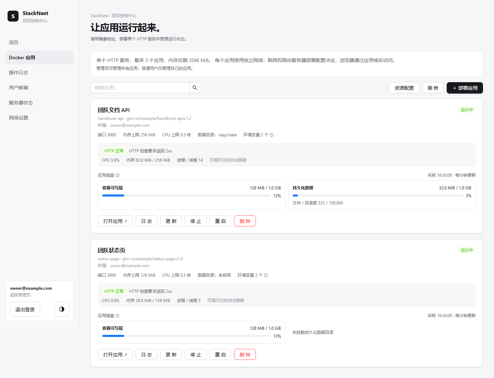
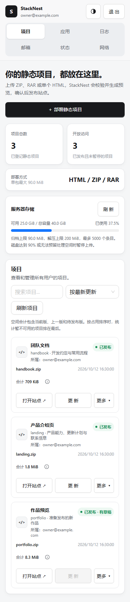
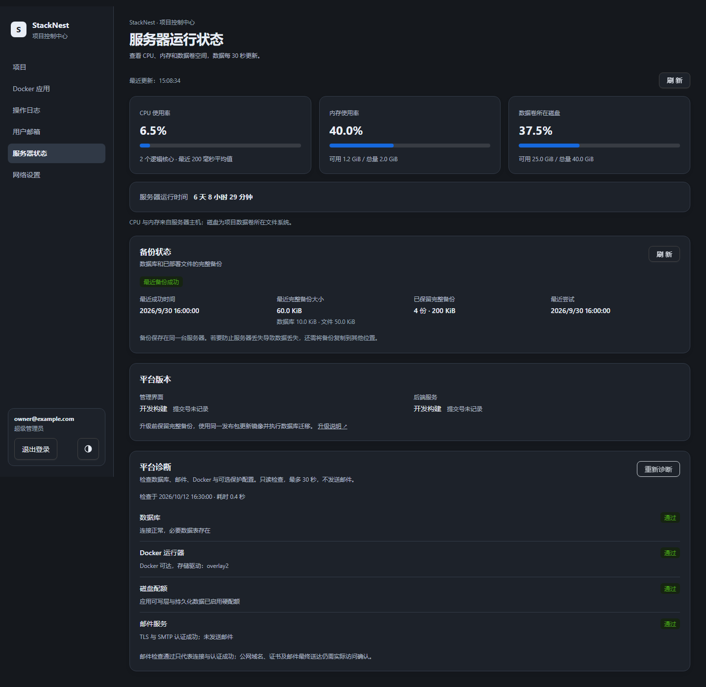

<div align="center">
  <picture>
    <source media="(prefers-color-scheme: dark)" srcset="docs/images/stacknest-banner-dark.svg">
    
  </picture>

  <p><strong>StackNest Web · 项目管理，从一个清晰的界面开始。</strong></p>
  <p>静态站点、Docker 应用、成员与服务器状态，在桌面和手机上都能管理。</p>

  <p>
    <a href="https://github.com/zby909/stack-nest-server/blob/main/docs/INSTALL_RELEASE.md"><strong>部署完整平台 →</strong></a> ·
    <a href="docs/DEVELOPMENT.md">前端开发</a> ·
    <a href="https://github.com/zby909/stack-nest-server/blob/main/docs/USAGE.md">使用指南</a> ·
    <a href="https://github.com/zby909/stack-nest-server">Server 仓库</a>
  </p>

  <p>
    <a href="LICENSE"></a>
    <a href="package.json"></a>
    <a href="tsconfig.app.json"></a>
    <a href="https://github.com/zby909/stack-nest-web/actions/workflows/check.yml"></a>
  </p>
</div>

## 从上传到发布

上传单个 HTML 或静态压缩包，先看独立预览，再确认发布。断点续传、版本回退和空间统计都在项目中完成。



## 让应用运行起来

填写已有 Docker 镜像地址，管理环境变量、启停与日志，查看健康状态和 CPU、内存、磁盘用量。



<details>
  <summary><strong>📱 手机布局 · 🌙 深色主题与平台诊断</strong></summary>
  <br>
  <p align="center"></p>
  
</details>

<sub>截图来自实际界面，使用虚构的演示数据。成员、管理员和超管按各自权限显示对应功能。</sub>

## 本地开发

准备 **Node.js 24** 和 `package.json` 指定的 pnpm，先启动 [Go API 与开发数据库](https://github.com/zby909/stack-nest-server/blob/main/docs/DEVELOPMENT.md)。

```bash
pnpm install --frozen-lockfile
pnpm dev
```

访问 `http://localhost:5173`。Vite 将 API 和静态预览请求交给本地 Go。[开发说明](docs/DEVELOPMENT.md)

## 检查与构建

```bash
pnpm exec playwright install chromium
pnpm check
pnpm build
```

`pnpm check` 包含类型检查、Lint，以及桌面和手机尺寸的浏览器回归。构建输出为 `dist/`，生产由平台 Nginx 提供。[测试说明](docs/TESTING.md) · [构建配置](docs/DEPLOYMENT.md)

文档截图可用 `pnpm screenshots` 重新生成，使用本地演示数据。

## 技术与协作

**React · TypeScript · Vite · Tailwind CSS 4 · Ant Design · Axios**

- 整套平台使用 [Server 的 Docker 部署方案](https://github.com/zby909/stack-nest-server/blob/main/docs/INSTALL_RELEASE.md)。
- 功能建议与整体设计在 [Server Issues](https://github.com/zby909/stack-nest-server/issues)讨论；界面改动见 [贡献指南](CONTRIBUTING.md)。
- 组件分工、前后端连接与维护方式见 [架构说明](https://github.com/zby909/stack-nest-server/blob/main/docs/ARCHITECTURE.md)。

Copyright 2026 zby909 and StackNest contributors. 使用 [Apache-2.0](LICENSE) 许可，第三方内容保留原许可，见 [NOTICE](NOTICE)。
